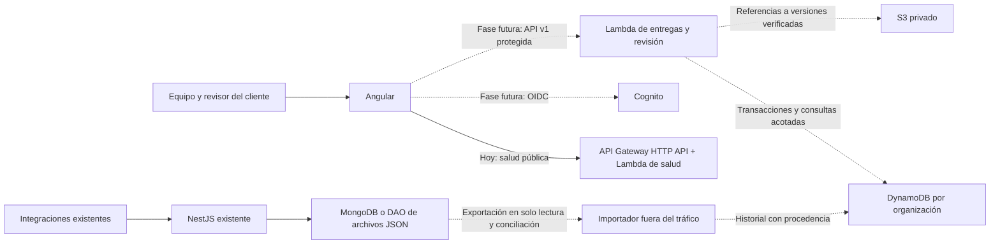

# Arquitectura de Logs of Change

## Alcance de esta rama

La base desplegable con AWS SAM contiene API Gateway HTTP API y una función Lambda pequeña que responde `GET /api/v1/health`. La ruta es pública y devuelve `{"status":"ok","service":"logs-of-change"}` con `Cache-Control: no-store`. Confirma el funcionamiento del proceso. La salud de los datos y el estado de las entregas tendrán controles propios al existir esas dependencias. La función usa Node.js 24, que AWS ofrece como runtime administrado. [Runtimes de AWS Lambda](https://docs.aws.amazon.com/lambda/latest/dg/lambda-runtimes.html)

La consola Angular independiente en [web](../../web/README.md) consume la ruta de salud del mismo origen. El servidor de desarrollo reenvía `/api/v1/**` a localhost. Para una publicación futura, el origen público de la consola deberá entregar el sitio estático y encaminar `/api/v1/*` al HTTP API. La plantilla actual carece de recursos de hosting, Cognito y datos de negocio.

[Fuente Mermaid](./diagrama.mmd)

## Inventario y decisión de reutilización

| Pieza existente | Evidencia | Decisión |
| --- | --- | --- |
| API NestJS/Fastify | [Módulo raíz](../../src/app.module.ts), [arranque](../../src/main.ts) y [controlador changelog](../../src/log/controllers/change-log.controller.ts) | Conservar el API y sus consumidores durante las fases aditivas. Usar sus DTO y la jerarquía de changelog, entradas, secciones, textos y medios como referencia para el contrato de lectura. Revisar los validadores uno por uno al mapear. |
| Servicios, repositorios y fábricas | [Módulo de logs](../../src/log/log.module.ts), [fábrica](../../src/log/DAOs/changeLog.factory.ts) y [contratos DAO](../../src/log/types/daoLog.type.ts) | Reutilizar nombres del dominio y formas de datos cuando corresponda. Las nuevas funciones reciben dependencias concretas. El patrón de separación entre lógica y persistencia sirve de referencia. |
| MongoDB | [DAO de cambio](../../src/log/DAOs/mongo/mongoChangeLog.dao.ts) y [esquema de proyecto](../../src/auth/schemas/project.schema.ts) | Exportar relaciones y conservar procedencia. Validar huérfanos, ObjectId, campos opcionales y fechas. Hay lecturas, actualizaciones y borrados por ID. Cada ruta nueva exige organización y pertenencia al proyecto. |
| DAO de archivos | [DAO de medios](../../src/log/DAOs/fs/fsLogMedia.dao.ts) y [configuración](../../src/config/config.loader.ts) | Sirve como fuente de exportación si existen archivos operativos. Escribe arreglos JSON completos y genera identificadores a partir del tamaño del arreglo. El importador debe detectar colisiones y referencias ambiguas. El módulo raíz también inicializa Mongoose cuando se elige el DAO de archivos. |
| Medios | [Tipo de archivo](../../src/shared/types/file.type.ts) y [DTO de medios](../../src/log/DTOs/createLogMedia.dto.ts) | Tratar las direcciones históricas como metadatos de origen. Copiar bytes únicamente desde fuentes autorizadas, validar tipo, tamaño e integridad y registrar las referencias que no se puedan recuperar. |
| Autenticación | [Módulo](../../src/auth/auth.module.ts), [validación](../../src/auth/services/auth.service.ts), [estrategia](../../src/auth/strategies/api-key.strategy.ts) y [proyecto](../../src/auth/schemas/project.schema.ts) | El middleware comprueba una lista global de API keys para las rutas existentes. Que un esquema tenga un arreglo de claves no demuestra aislamiento. La nueva API tendrá autenticación de personas y autorización por organización y proyecto. Excluir secretos, listas de claves y tokens de toda exportación. |

La implementación heredada mezcla versiones de NestJS. En Node.js 24 el `npm ci` estricto falla por la relación entre `@nestjs/core@10` y `@nestjs/common@11`. Instalando con `--legacy-peer-deps` se observaron errores preexistentes de Passport, Fastify y esquemas al compilar, y 13 suites unitarias fallaron frente a 2 exitosas. La compilación raíz incluye `src/` y Jest usa `src/` como raíz. [Paquete NestJS](../../package.json) · [Configuración del build](../../tsconfig.build.json)

## Arquitectura de las siguientes fases

- **Identidad y permisos.** Cognito emite tokens OIDC de usuario. API Gateway validará emisor, audiencia y caducidad mediante un autorizador JWT para rutas protegidas. En la aplicación se comprobará la pertenencia activa del `sub` a la organización y su permiso sobre el proyecto. El identificador de organización en la ruta es contexto de acceso y se valida contra la identidad. Las credenciales de integraciones deberán tener alcance por organización y operación, revocación y rotación. Ninguna clave de integración permite aprobar como persona.
- **Datos.** DynamoDB en modo bajo demanda con recuperación a un punto en el tiempo almacena las relaciones y los estados. Las consultas serán paginadas y acotadas a claves de organización y proyecto. Las validaciones de autorización y de versión ocurren al ejecutar cada comando.
- **Archivos.** S3 privado con bloqueo de acceso público, cifrado y versionado. Emitir URL firmada breve después de autorizar al actor. Para adjuntar un archivo, verificar tamaño, tipo y suma de comprobación de la versión correspondiente. La entrega conserva el ID de versión, el tamaño y el hash, además de su procedencia. Mantener la retención de evidencia separada de la de cargas temporales.
- **Observabilidad.** Usar métricas de errores, latencia, resultados de conciliación y accesos denegados, con identificadores de correlación sin carga útil ni tokens. La plantilla inicial retiene logs de la función de salud 14 días. Acordar retención, límites y alertas de costes de los datos de negocio antes del piloto.

### Entidades y accesos propuestos

| Entidad | Clave de partición | Clave de ordenamiento | Acceso |
| --- | --- | --- | --- |
| Miembro de una organización | `TENANT#t` | `MEMBER#sub` | Verificar pertenencia y rol de organización. |
| Proyecto de una organización | `TENANT#t` | `PROJECT#p` | Listar y verificar proyectos de la organización. |
| Permiso de proyecto | `TENANT#t#PROJECT#p` | `PERMISSION#sub` | Verificar permiso del actor sobre el proyecto. |
| Resumen de entrega | `TENANT#t#PROJECT#p` | `RELEASE#r` | Listar entregas de un proyecto y leer su versión y estado actuales. |
| Revisión y decisión de entrega | `TENANT#t#PROJECT#p#RELEASE#r` | `REV#n`, `DECISION#n` | Consultar el historial versionado de una entrega. |
| Recibo de operación | `TENANT#t#PROJECT#p` | `IDEMP#actor#operation#key` | Repetir la respuesta del mismo comando con el mismo cuerpo. |

`t`, `p`, `r` y `n` representan organización, proyecto, entrega y revisión. Una consulta por ID valida también que el proyecto de la ruta pertenezca a la organización. El acta solo se emite a partir de una revisión y una decisión persistidas.

### Mutaciones e integridad

Para presentar una entrega, guardar una revisión con el manifiesto canónico de contenido, un digest SHA-256 y las referencias verificadas de adjuntos. La revisión presentada es inmutable. La decisión tiene identidad del revisor, estado, fecha del servidor y referencia al manifiesto. Una solicitud de cambios abre una revisión nueva. Una corrección posterior conserva las versiones anteriores. La integridad y la identidad de aplicación no equivalen a una firma legal. Las políticas de retención y, si se requieren, las garantías WORM se definirán antes de prometerlas.

Cada mutación recibe `Idempotency-Key`. El recibo vincula organización, proyecto, actor, operación, recurso y digest del cuerpo normalizado. Una transacción DynamoDB registra el recibo, verifica el estado o la revisión previa y escribe el cambio. Una repetición autorizada con el mismo digest devuelve la respuesta registrada. El mismo identificador con otro digest produce `409`. Las decisiones sobre una misma revisión compiten por una sola clave `DECISION#n` y una condición de revisión pendiente. Declarar la ventana de reintentos y probar concurrencia antes de publicar la ruta. [Transacciones DynamoDB](https://docs.aws.amazon.com/amazondynamodb/latest/developerguide/transaction-apis.html)

La escritura de un archivo en S3 precede a la confirmación transaccional de su referencia. Los objetos que quedan sin referencia pasan a limpieza posterior cuando vence su período de carga temporal. La evidencia aceptada queda referida por versión y se conserva con el control de retención correspondiente. [Versionado S3](https://docs.aws.amazon.com/AmazonS3/latest/userguide/Versioning.html)

### Procesamiento diferido

Presentar y decidir una revisión son operaciones síncronas de una transacción. Un aviso o una exportación que exceda el tiempo de respuesta podrá tomar un registro de salida persistido junto con el evento y procesarlo con SQS y un consumidor idempotente. Step Functions se evaluará cuando exista un proceso de varios pasos, con esperas o compensaciones observables, y se pueda justificar su coste y operación.

## Estrategia de migración

1. Mantener el API existente en su origen. La nueva ruta de salud usa un prefijo exclusivo y datos independientes.
2. Capturar contratos reales de lectura y seleccionar un proyecto piloto con un mapeo explícito de organización. Exportar una copia de solo lectura y reconciliar conteos, referencias principales y hashes. Los conflictos se registran con motivo y bloquean el corte hasta resolverlos.
3. Consultar la proyección nueva en sombra de forma periódica y comparar resultados con muestras del origen. Para las rutas migradas por primera vez, hacer un corte de lectura por proyecto mediante una opción reversible. La fuente existente sigue atendiendo escrituras previas al corte.
4. Activar comandos de revisión y decisión solo para proyectos autorizados y con pruebas de aislamiento, idempotencia, retención y restauración aprobadas. Asignar un único escritor por entidad y proyecto. La base nueva será dueña de las aprobaciones desde la primera emisión.
5. Si se detecta un problema antes de aprobar, revertir el tráfico de lectura del proyecto. Después de aprobar, congelar escrituras afectadas y restaurar o corregir en el sistema nuevo. Conservar las decisiones allí y usar la lectura heredada para el historial del origen. Revisar alertas, restauraciones y evidencia antes de extender el corte.

[ADR de migración](./adr/0001-migracion-incremental.md) · [Plan de implementación](../../plan/architecture-serverless-product-1.md)
