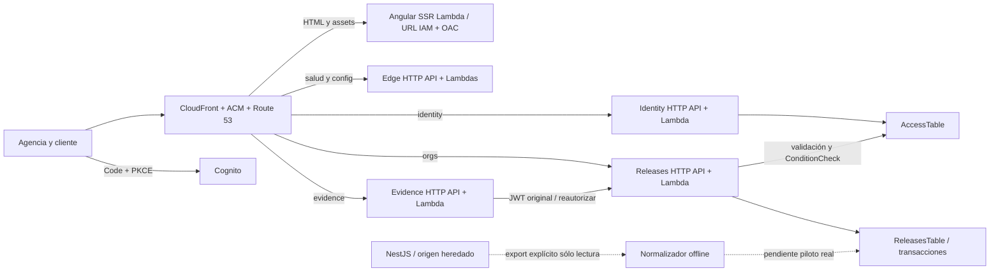

# Arquitectura de Logs of Change

## Servicios y límites

La arquitectura es de **microservicios serverless en AWS**, con Angular servido mediante Lambda SSR. Sigue el patrón local del portafolio, usando servicios, dominios y datos propios de Logs of Change. [ADR de arquitectura](adr/0002-microservicios-serverless.md) y [decisión de identidad vigente](adr/0003-logs-of-change-identidad.md).

| Servicio / stack | Responsabilidad y propiedad | Implementación |
| --- | --- | --- |
| Edge y frontend | Angular SSR, assets del bundle, salud, configuración pública, DNS/TLS y enrutamiento | `serverless/template.yaml`, Lambda Node24 ARM64, Function URL IAM, CloudFront OAC, ACM, Route 53 |
| Identidad | Personas, login y pertenencia a organizaciones/proyectos | `services/identity/template.yaml`, Cognito Code+PKCE, HTTP API y Lambda, AccessTable DynamoDB |
| Entregas | Borradores, revisiones, decisiones, historial y recibos | `services/releases/template.yaml`, HTTP API JWT, Lambda, ReleasesTable DynamoDB, bucket privado preparado |
| Evidencia | Acta JSON desde una revisión decidida e íntegra | `services/evidence/template.yaml`, HTTP API JWT y Lambda; sólo consulta la API de entregas |

Cada stack es desplegable y actualizable por separado mediante `deploy.mjs --service=...`. Comparten un contrato HTTP versionado y un artefacto backend con entradas distintas, no un proceso NestJS común. Entregas consulta AccessTable y comprueba las mismas claves en la transacción para impedir mutaciones con un permiso revocado entre lectura y escritura. Sólo identidad es dueña de los permisos; el rol de entregas no los modifica. Evidencia no tiene permisos sobre las tablas de negocio.

HTML y API tienen caché desactivada. Los assets con hash se sirven desde el bundle de la Lambda en este corte, manteniendo publicación atómica. Se puede separar una distribución de assets S3 cuando el tráfico lo justifique; no es una dependencia para cumplir el hosting pedido. El origen Lambda no permite acceso anónimo directo: OAC y permisos limitados al ARN de esta distribución.

## Identidad, autorización y datos

Cognito emite tokens de acceso, obtenidos por Authorization Code con PKCE; el cliente público no tiene secreto ni usa flujo implícito. El frontend descubre la configuración en `GET /api/v1/config`. El API Gateway comprueba emisor, cliente y scope `openid`; las operaciones de entregas exigen `token_use=access`. La identidad del actor se obtiene exclusivamente del JWT validado.

Cada operación comprueba membresía activa de organización, proyecto activo y permiso activo de proyecto. Los roles editor/administrator preparan y presentan; reviewer/administrator deciden. Autor y presentador no pueden decidir su propia revisión. Las lecturas se acotan por organización/proyecto; los cursores no permiten cambiar ese alcance. El descubrimiento usa un índice por actor y vuelve a comprobar las membresías de manera consistente.

| Entidad | PK | SK |
| --- | --- | --- |
| Membresía | TENANT#t | MEMBER#sub |
| Proyecto | TENANT#t | PROJECT#p |
| Permiso | TENANT#t#PROJECT#p | PERMISSION#sub |
| Entrega | TENANT#t#PROJECT#p | RELEASE#r |
| Revisión / decisión | TENANT#t#PROJECT#p#RELEASE#r | REV#n / DECISION#n |
| Recibo | TENANT#t#PROJECT#p | IDEMP#digest(actor,operación,clave) |

Las tablas usan pago por demanda, cifrado y recuperación a un punto en el tiempo. La tabla de entregas tiene protección de borrado y Retain. Logs por servicio retienen 14 días y no incluyen tokens ni cuerpos de entregas.

## Revisiones e integridad

Flujo: borrador → pendiente de revisión → aceptada o cambios solicitados. Una solicitud de cambios permite crear otra revisión y volver a presentarla. Las revisiones presentadas son inmutables; cada decisión apunta al digest de su manifiesto. Un manifiesto JSON con claves ordenadas recursivamente produce un SHA-256 determinista. El acta recupera revisión y decisión mediante la API autorizada, comprueba el manifiesto y exporta identidad, fecha, contenido y referencias. No equivale a firma legal ni a garantías WORM.

Toda mutación requiere `Idempotency-Key`, asociada al actor, organización, proyecto, operación y digest del cuerpo normalizado. La transacción DynamoDB comprueba permiso vigente, versión previa, unicidad de decisión y recibo. La misma petición devuelve la respuesta original; otra carga con igual clave produce 409. Los recibos no caducan: no se abre una ventana que permita repetir operaciones antiguas. Dos revisores compiten por una única decisión de revisión.

El bucket de evidencia es privado, cifrado y versionado, con TLS obligatorio. Todavía se rechazan adjuntos no vacíos: habilitarlos requiere cargas con tamaño/tipo/hash y versión verificados. El frontend no ofrece una carga que el servidor no pueda garantizar.

Para un incidente, el campo booleano `writesFrozen` del proyecto permite bloquear comandos sin retirar lecturas autorizadas. True o un valor malformado producen423 WRITES_FROZEN, incluso al repetir un recibo; false o campo ausente permiten operar. La condición del proyecto se comprueba en la transacción y una carrera con la congelación también bloquea la escritura. La revocación de permisos sigue teniendo prioridad y responde403.

## Inventario heredado y migración

Se conserva el API NestJS/Fastify de `src/`, sus DTO y la jerarquía de changelog, entradas, secciones, textos y medios como referencia del contrato de lectura. Sus servicios, repositorios y DAO MongoDB/JSON siguen disponibles para exportación autorizada. El middleware heredado usa claves globales: no constituye autorización de personas por proyecto y no se reutiliza para aprobar.

El paquete heredado mezcla `@nestjs/core@10` con `@nestjs/common@11`. El documento anterior registraba fallo de instalación estricta y errores de compilación/pruebas con legacy-peer-deps; este trabajo no vuelve a instalar ni corregir ese árbol. Los nuevos servicios y Angular usan lockfiles independientes.

El importador offline sólo abre un JSON explícito y produce un informe/proyección en stdout; excluye claves, personas y suscripciones, normaliza IDs/fechas y detecta huérfanos, colisiones, proyectos ajenos y pérdida de paridad. La historia conserva procedencia y nunca recibe una aprobación inventada. La comprobación sintética no demuestra paridad de un origen real.

Antes de un corte: elegir proyecto y organización verificados, exportar en sólo lectura, conciliar referencias y hashes, cargar en entorno aislado, comparar con el origen y demostrar selección reversible de lectura. Las nuevas aprobaciones pertenecen al servicio de entregas desde su creación. Después de una decisión, un incidente congela comandos y conserva evidencia; no devuelve la autoridad de aprobación al sistema heredado.

## Entornos y operación

Los nombres físicos AWS, dominios, paquetes y contratos nuevos usan logsofchange; la marca es Logs of Change. Región: us-east-1. Desarrollo: `dev.logsofchange.lynxpardelle.com`; pruebas: `test.logsofchange.lynxpardelle.com`; producción prevista: `logsofchange.lynxpardelle.com`. Certificados específicos cubren los hostnames publicados y los registros son propios. Los cinco stacks de cada entorno aíslan tablas, usuarios, buckets, API y logs.

Development y testing están publicados y verificados: Angular SSR, DNS/TLS, OAuth Code+PKCE, QA de escritorio/móvil y flujo completo de solicitud de cambios, nueva revisión, aceptación y actas íntegras. La promoción a testing se realizó por pull request con merge commit y CI correcta. Los datos/usuarios sintéticos se limpiaron al terminar; esto no acredita la aceptación de un piloto real ni las cargas de adjuntos todavía pendientes.

La cadena sigue development → testing → main. El trabajo nuevo y las correcciones se integran primero en development; testing recibe promociones por PR. `deploy.mjs` exige la rama del entorno antes de mutar AWS; producción exige main y `--approve-production=true` tras revisión explícita. Main permanece sin cambios y producción no se ha desplegado en esta entrega.

[Plan](../../plan/architecture-serverless-product-1.md) · [Contrato v1](contracts/releases-v1.md) · [Runbook](../operations/runbook.md) · [Desarrollo verificado](../operations/development-logsofchange.md) · [Testing verificado](../operations/testing-logsofchange.md).
