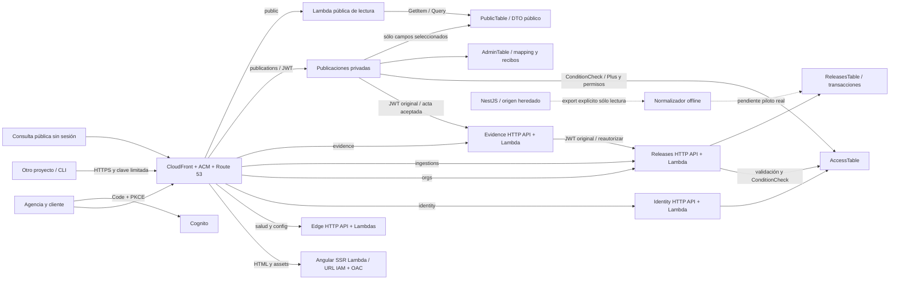

# Arquitectura de Logs of Change

## Servicios y límites

La arquitectura es de **microservicios serverless en AWS**, con Angular servido mediante Lambda SSR. Sigue el patrón local del portafolio, usando servicios, dominios y datos propios de Logs of Change. [ADR de arquitectura](adr/0002-microservicios-serverless.md) y [decisión de identidad vigente](adr/0003-logs-of-change-identidad.md).

| Servicio / stack | Responsabilidad y propiedad | Implementación |
| --- | --- | --- |
| Edge y frontend | Angular SSR, assets del bundle, salud, configuración pública, DNS/TLS y enrutamiento | `serverless/template.yaml`, Lambda Node24 ARM64, Function URL IAM, CloudFront OAC, ACM, Route 53 |
| Identidad | Personas, login, acceso por proyecto y gestión de claves portables | `services/identity/template.yaml`, Cognito Code+PKCE, HTTP API y Lambda, AccessTable DynamoDB |
| Entregas | Borradores, ingesta por clave limitada, revisiones, decisiones, historial y recibos | `services/releases/template.yaml`, HTTP API JWT para personas y ruta de ingesta con autenticación de clave en servicio, ReleasesTable DynamoDB y bucket privado preparado |
| Evidencia | Acta JSON desde una revisión decidida e íntegra | `services/evidence/template.yaml`, HTTP API JWT y Lambda; sólo consulta la API de entregas |
| Publicaciones | Selección explícita de revisiones aceptadas y proyección pública | `services/publications/template.yaml`, HTTP API, Lambda privada JWT, AdminTable y PublicTable; Lambda pública sólo con GetItem/Query sobre PublicTable |

Cada stack es desplegable y actualizable por separado mediante `deploy.mjs --service=...`. Comparten un contrato HTTP versionado y un artefacto backend con entradas distintas, no un proceso NestJS común. Entregas y publicaciones consultan AccessTable y comprueban sus condiciones en la transacción. Sólo identidad administra las claves; entregas y publicaciones no modifican permisos ni planes. Evidencia no tiene permisos sobre las tablas de negocio. El lector público no tiene configuración ni permisos para consultar AccessTable, ReleasesTable o AdminTable.

HTML y API tienen caché desactivada. Los assets con hash se sirven desde el bundle de la Lambda en este corte, manteniendo publicación atómica. Se puede separar una distribución de assets S3 cuando el tráfico lo justifique; no es una dependencia para cumplir el hosting pedido. El origen Lambda no permite acceso anónimo directo: OAC y permisos limitados al ARN de esta distribución.

## Identidad, autorización y datos

Cognito emite tokens de acceso, obtenidos por Authorization Code con PKCE; el cliente público no tiene secreto ni usa flujo implícito. El frontend descubre la configuración en `GET /api/v1/config`. En las rutas personales, API Gateway comprueba emisor, cliente y scope `openid`; los handlers de entregas, gestión de integraciones y publicaciones comprueban además `token_use=access`. La identidad personal del actor se obtiene exclusivamente del JWT validado.

Las operaciones personales comprueban membresía activa de organización, proyecto activo y permiso activo de proyecto. Los roles editor/administrator preparan y presentan; reviewer/administrator deciden. Autor y presentador no pueden decidir su propia revisión. Las lecturas privadas se acotan por organización/proyecto; los cursores no permiten cambiar ese alcance. El descubrimiento usa un índice por actor y vuelve a comprobar las membresías de manera consistente. La ruta de ingesta utiliza una identidad de máquina distinta, limitada a crear borradores; no sustituye una sesión personal.

| Entidad | PK | SK |
| --- | --- | --- |
| Membresía | TENANT#t | MEMBER#sub |
| Proyecto | TENANT#t | PROJECT#p |
| Permiso | TENANT#t#PROJECT#p | PERMISSION#sub |
| Plan de plataforma | TENANT#t | PRODUCT |
| Clave de integración, sólo hash | TENANT#t#PROJECT#p | INTEGRATION#keyId |
| Recibo de gestión de claves | TENANT#t#PROJECT#p | KEYREQUEST#digest |
| Entrega | TENANT#t#PROJECT#p | RELEASE#r |
| Revisión / decisión | TENANT#t#PROJECT#p#RELEASE#r | REV#n / DECISION#n |
| Recibo | TENANT#t#PROJECT#p | IDEMP#digest(actor,operación,clave) |
| Configuración pública privada, en AdminTable | TENANT#t#PROJECT#p | CONFIG |
| Publicación privada, en AdminTable | TENANT#t#PROJECT#p | PUBLICATION#releaseId |
| Reserva global de slug, en AdminTable | SLUG#slug | CLAIM |
| Proyecto público, en PublicTable | PROJECT#slug | META |
| Revisión publicada, en PublicTable | PROJECT#slug | RELEASE#publicUUID |

Las tablas usan pago por demanda, cifrado y recuperación a un punto en el tiempo. Entregas y las dos tablas de publicaciones tienen protección de borrado y Retain. Los recibos de publicaciones permanecen en AdminTable, dentro de la partición privada del proyecto. Logs por servicio retienen 14 días y no incluyen tokens ni cuerpos de entregas.

## Revisiones e integridad

Flujo: borrador → pendiente de revisión → aceptada o cambios solicitados. Una solicitud de cambios permite crear otra revisión y volver a presentarla. Las revisiones presentadas son inmutables; cada decisión apunta al digest de su manifiesto. Un manifiesto JSON con claves ordenadas recursivamente produce un SHA-256 determinista. El acta recupera revisión y decisión mediante la API autorizada, comprueba el manifiesto y exporta identidad, fecha, contenido y referencias. No equivale a firma legal ni a garantías WORM.

Toda mutación requiere `Idempotency-Key`, asociada al actor, organización, proyecto, operación y digest del cuerpo normalizado. La transacción DynamoDB comprueba permiso vigente, versión previa, unicidad de decisión y recibo. La misma petición devuelve la respuesta original; otra carga con igual clave produce 409. Los recibos no caducan: no se abre una ventana que permita repetir operaciones antiguas. Dos revisores compiten por una única decisión de revisión.

El bucket de evidencia es privado, cifrado y versionado, con TLS obligatorio. Todavía se rechazan adjuntos no vacíos: habilitarlos requiere cargas con tamaño/tipo/hash y versión verificados. El frontend no ofrece una carga que el servidor no pueda garantizar.

Para un incidente, el campo booleano `writesFrozen` del proyecto permite bloquear comandos de entregas, ingesta, nuevas claves y publicación sin retirar lecturas autorizadas. True o un valor malformado producen 423 WRITES_FROZEN, incluso al repetir un recibo; false o campo ausente permiten esos comandos. La condición se comprueba en la transacción y una carrera con la congelación también bloquea la escritura. La revocación de permisos sigue teniendo prioridad y responde 403. Despublicar y revocar claves permanecen disponibles para administradores vigentes.

## Integraciones, plan y publicación pública

La API portable recibe `X-Logsofchange-Key` por HTTPS. La clave tiene ID aleatorio y secreto de 256 bits, caducidad máxima de 90 días y alcance `releases:create`. AccessTable sólo guarda su hash SHA-256 y metadatos. La consola devuelve el secreto una sola vez y el CLI lo lee desde `LOGSOFCHANGE_API_KEY`, sin argumentos de credencial ni archivos de configuración secretos. La ruta de ingesta es Auth NONE en Gateway porque no usa Cognito, pero el servicio autentica la clave, valida proyecto, hash, alcance, caducidad y Plus, y repite esas condiciones en la transacción. Revocación, vencimiento y congelación bloquean también replays.

Free conserva las aprobaciones manuales. La fila `TENANT#org / PRODUCT` habilita Plus con `plan: plus`, `active: true` y `expiresAt` opcional en epoch. Sin fila válida, el sistema cierra las capacidades Plus. Sólo una operación AWS de plataforma puede asignar ese plan; la API de cliente no puede otorgarlo. El plan corresponde a la organización y no representa un cobro ni una integración de billing.

Publicar exige JWT personal, administrador vigente, Plus y escrituras abiertas. La Lambda privada consulta Evidence API con el JWT original, verifica digest, organización/proyecto/entrega/revisión y decisión aceptada, y construye una proyección con título y, sólo si se seleccionan, resumen y cambios. Los datos públicos incluyen UUID independiente, revisión y fechas de aceptación/publicación. No incluyen actores, motivos, emails, IDs privados, procedencia, recibos o actas completas.

La escritura de AdminTable y PublicTable es atómica y vuelve a comprobar membresía, proyecto, rol y plan. La reserva global de slug evita que otro proyecto lo tome; el mapping permanece después de retirar la última publicación. `GET /api/v1/public/projects/{slug}` usa exclusivamente PublicTable, sin token, con cursores acotados y páginas de 1 a 50 elementos. `/p/{slug}` muestra esa proyección y contadores de publicaciones consultadas. Un slug sin publicaciones devuelve 404. La respuesta permite CORS sin credenciales y usa no-store; las rutas privadas y de ingesta no habilitan CORS general.

Despublicar o revocar una clave siguen disponibles para administradores vigentes aunque Plus esté vencido o el proyecto tenga escrituras congeladas. Despublicar elimina futuras lecturas de la proyección, sin prometer borrar copias externas. Las publicaciones existentes no se retiran automáticamente por cambiar a Free. [Contrato de integración y consulta pública](contracts/integrations-public-v1.md).

## Inventario heredado y migración

Se conserva el API NestJS/Fastify de `src/`, sus DTO y la jerarquía de changelog, entradas, secciones, textos y medios como referencia del contrato de lectura. Sus servicios, repositorios y DAO MongoDB/JSON siguen disponibles para exportación autorizada. El middleware heredado usa claves globales: no constituye autorización de personas por proyecto y no se reutiliza para aprobar.

El paquete heredado mezcla `@nestjs/core@10` con `@nestjs/common@11`. El documento anterior registraba fallo de instalación estricta y errores de compilación/pruebas con legacy-peer-deps; este trabajo no vuelve a instalar ni corregir ese árbol. Los nuevos servicios y Angular usan lockfiles independientes.

El importador offline sólo abre un JSON explícito y produce un informe/proyección en stdout; excluye claves, personas y suscripciones, normaliza IDs/fechas y detecta huérfanos, colisiones, proyectos ajenos y pérdida de paridad. La historia conserva procedencia y nunca recibe una aprobación inventada. La comprobación sintética no demuestra paridad de un origen real.

Antes de un corte: elegir proyecto y organización verificados, exportar en sólo lectura, conciliar referencias y hashes, cargar en entorno aislado, comparar con el origen y demostrar selección reversible de lectura. Las nuevas aprobaciones pertenecen al servicio de entregas desde su creación. Después de una decisión, un incidente congela comandos y conserva evidencia; no devuelve la autoridad de aprobación al sistema heredado.

## Entornos y operación

Los nombres físicos AWS, dominios, paquetes y contratos nuevos usan logsofchange; la marca es Logs of Change. Región: us-east-1. Desarrollo: `dev.logsofchange.lynxpardelle.com`; pruebas: `test.logsofchange.lynxpardelle.com`; producción: `logsofchange.lynxpardelle.com`. Certificados específicos cubren los hostnames y los registros son propios. Cada entorno publicado tiene seis stacks —identidad, entregas, evidencia, publicaciones, edge y artefactos—, aislando tablas, usuarios, buckets, API y logs.

La base y la adición de integraciones portables y consultas públicas están publicadas y verificadas en development, testing y producción: Angular SSR, DNS/TLS, OAuth Code+PKCE, QA de escritorio/móvil y aprobación con actas íntegras. La adición llegó a producción por el [PR #343](https://github.com/LynxPardelle/logs-of-change/pull/343), revisión de aplicación `5b30c8633bd2e1311f266206e300b1a5032acbc6`, con [CI correcta](https://github.com/LynxPardelle/logs-of-change/actions/runs/44641204991). Pasaron 17 comprobaciones desplegadas por entorno, incluidas creación de claves, CLI real, publicación humana, dashboard anónimo, despublicación y revocación. Los resultados de cada entorno constan en el [informe de producción y rollout](../operations/production-logsofchange.md). Se limpió el ámbito sintético sin fallos y se verificaron cero usuarios y cero filas en las cuatro tablas de producción. Estas comprobaciones no acreditan la aceptación de un piloto real ni las cargas de adjuntos todavía pendientes.

La cadena sigue development → testing → main. El trabajo nuevo y las correcciones se integran primero en development; testing y main reciben promociones por PR con merge commit. `deploy.mjs` exige la rama del entorno antes de mutar AWS; producción exige main y `--approve-production=true` tras revisión explícita.

[Plan](../../plan/architecture-serverless-product-1.md) · [Contrato de aprobaciones](contracts/releases-v1.md) · [Contrato de integraciones](contracts/integrations-public-v1.md) · [Runbook](../operations/runbook.md) · [Desarrollo verificado](../operations/development-logsofchange.md) · [Testing verificado](../operations/testing-logsofchange.md) · [Producción y rollout](../operations/production-logsofchange.md).
